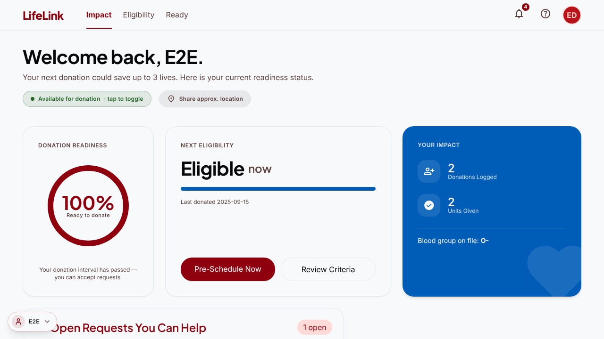
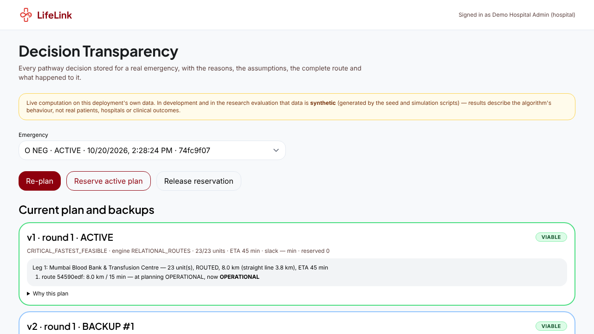
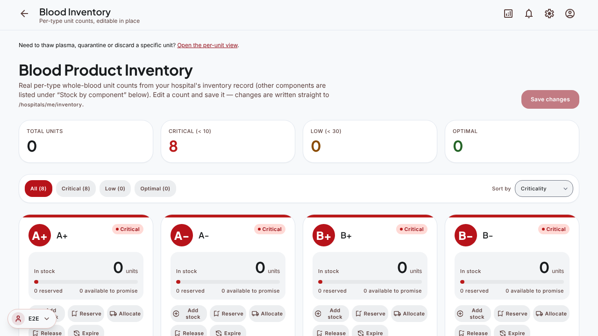
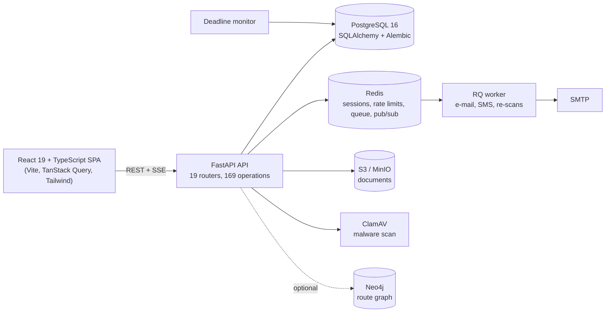

# LifeLink

**A full-stack platform for coordinating emergency blood transfusions:** patients and families raise blood requests and SOS emergencies, donors respond, hospitals and blood banks manage inventory and shipments, and administrators govern the network.


> **Status: research prototype.** All data in this repository is synthetic. LifeLink has not been clinically validated or approved and must not be used for real patients or donors. See [Project status](#project-status-and-limitations).

---

## Why

An emergency transfusion depends on finding compatible blood, reserving it, moving it between facilities and handing it over, and on finding donors when stock runs out. These steps usually live in separate systems and phone calls. LifeLink brings them into one auditable workflow.

## Features

| Area | What it does |
|---|---|
| **Blood requests and SOS emergencies** | Patients, families and hospitals raise requests with blood type, component, units and urgency; emergencies carry a deadline and location |
| **Donor shortlist** | Hard eligibility checks first (blood compatibility, donation interval, availability, distance, existing commitments), then an **explainable priority score** from 7 weighted factors. Donors are contacted in batches with response timeouts, and eligibility is re-checked before confirmation |
| **Failure-aware pathway planning** | Plans delivery over recorded transport routes using component compatibility and shelf life, keeps up to three validated backup plans, and re-plans only the affected emergencies when a route fails |
| **Inventory and blood-unit lifecycle** | Per-component stock, reservations, expiry, quarantine and traceability |
| **Shipments** | Hand-off from plan to shipment, cold-chain status and receipt |
| **Donations and certificates** | Donation logging, staff verification and verifiable certificates |
| **Live updates** | Server-Sent Events (SSE) push changes to every open page |
| **Security and privacy** | Role-based access for 5 roles, CSRF/origin checks, rate limiting, ClamAV malware scanning of uploads, role-specific data minimisation, and a **tamper-evident SHA-256 hash-chained audit log** with HMAC checkpoints |
| **Notifications** | E-mail through an RQ worker (SMTP) and an SMS adapter (MSG91) |

## Screenshots

| Donor dashboard | Pathway plan with backups |
|---|---|
|  |  |

| Hospital inventory | Donor shortlist (synthetic demo) |
|---|---|
|  |  |

## Architecture



## Tech stack

| Layer | Technologies |
|---|---|
| Backend | Python 3.11, FastAPI, Pydantic, SQLAlchemy, Alembic, PostgreSQL 16, Redis, RQ |
| Frontend | React 19, TypeScript, Vite, Tailwind CSS, TanStack Query |
| Storage and services | S3 / MinIO, ClamAV, SMTP (Mailpit in development), MSG91 adapter, optional Neo4j |
| Testing | pytest, Vitest, Testing Library, Playwright, axe-core (accessibility) |
| DevOps | Docker, Docker Compose, GitHub Actions, Ruff, ESLint |

## Testing and quality

| Check | Result |
|---|---|
| Backend tests (pytest on real PostgreSQL and Redis) | 1,480+ tests |
| Frontend unit tests (Vitest) | 184 / 184 |
| Browser end-to-end tests (Playwright) | 107 passed |
| Failure injection (Redis, PostgreSQL, MinIO, ClamAV, worker and SMTP stopped and restarted) | 27 / 27 |
| Native and Docker clean starts | pass (Neo4j not available in the test environment) |

The privacy and release reviews are in [`docs/release/`](docs/release/), and every reproducible command is in [`docs/QA/REPRODUCE_TESTS.md`](docs/QA/REPRODUCE_TESTS.md).

## Getting started

**Requirements:** Python 3.11+, Node.js 20+, PostgreSQL 16 and Redis 7 (or Docker).

### Backend

```bash
cd backend
python3 -m venv .venv
.venv/bin/pip install --require-hashes --no-deps -r requirements-dev.lock
.venv/bin/pip install --no-deps -e .
cp .env.example .env                              # set SECRET_KEY; never commit .env
.venv/bin/alembic upgrade head
.venv/bin/python -m scripts.seed_demo_data        # synthetic demo data
.venv/bin/uvicorn app.main:app --port 8000
.venv/bin/python -m app.workers.worker            # background jobs (second terminal)
```

### Frontend

```bash
cd frontend
npm ci
npm run dev                                       # http://localhost:5173
```

### Everything in Docker

```bash
cd backend
cp .env.example .env                              # set SECRET_KEY and AUDIT_CHECKPOINT_KEY
docker compose up -d --build                      # API :8000, web app :5173
```

Demo accounts and a scripted walkthrough of the donor shortlist are in [`docs/remediation/DEMO_GUIDE.md`](docs/remediation/DEMO_GUIDE.md).

### Run the tests

```bash
cd backend  && .venv/bin/python -m pytest
cd frontend && npx vitest run && npx tsc --noEmit && npx eslint .
```

## Project status and limitations

* **Synthetic data only.** Every hospital, donor and patient is generated by the seed scripts.
* **Not clinically approved.** Eligibility rules (for example donation intervals) and the priority weights are provisional and need review by transfusion-medicine and regulatory experts.
* **Privacy approval pending.** Retention periods and some patient-facing details are open decisions, listed in [`docs/release/PRIVACY_SECURITY_REVIEW.md`](docs/release/PRIVACY_SECURITY_REVIEW.md).
* **External services not verified live:** Neo4j, Gmail, MSG91 SMS and a live geocoder were only tested against stand-ins.
* **The ranking evaluation is synthetic.** It shows behaviour on a simulated network, not real-world effectiveness.

The full release checklist is in [`docs/release/RELEASE_GATES_2026-11-03.md`](docs/release/RELEASE_GATES_2026-11-03.md). Current decision: **not ready for production**.

## Repository layout

```
backend/    FastAPI app, Alembic migrations, workers, scripts, pytest suite
frontend/   React + TypeScript app, Vitest and Playwright tests
docs/       design, API and database maps, QA evidence, release reviews
  phase-reports/   development reports for each build phase
  DEVELOPMENT_LOG.md   the full development and audit history
```

## Author

**Monijeeta Moitra**, B.Tech Computer Science and Engineering (Bioinformatics), VIT Vellore
[GitHub](https://github.com/monijeetam-004) · [LinkedIn](https://linkedin.com/in/monijeeta-moitra)

LifeLink is also described in a co-authored research paper; see [`docs/paper/`](docs/paper/).
