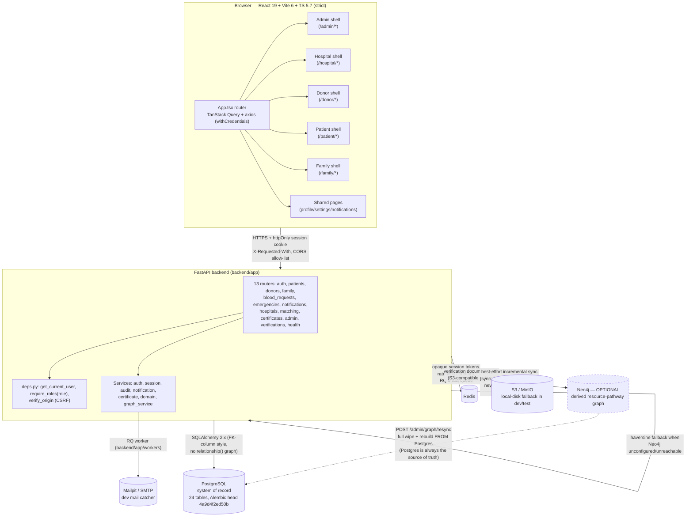

# LifeLink — Phase 0 Repository Audit

**Scope:** Read-only, evidence-based audit of the LifeLink codebase (backend, frontend, design exports, database, security posture) as it exists on disk today. No application code was modified, fixed, or refactored to produce this report. This document is Phase 0 of a 30-phase engineering plan — its job is to establish ground truth, not to fix anything found.

**Repository root:** `/home/claude/lifelink_impl/project` (backend + frontend + docs). The Stitch design export lives one level up, at `/home/claude/lifelink_impl/design_export/stitch_lifelink_shared_foundation_platform/`.

---

## 1. Executive summary

**Correction to the record up front:** the task template that seeded this audit assumed a Flask backend. That is incorrect. The backend is **FastAPI** (`backend/app/main.py`, `FastAPI(title="LifeLink API", ...)`) with SQLAlchemy 2.x declarative models (plain FK columns, no `relationship()` mapper graph — confirmed across all 18 model files), Alembic migrations, PostgreSQL as the system of record, Redis for sessions/rate-limits/queueing, and an optional Neo4j graph engine. Authentication is cookie-based with opaque, Redis-backed session tokens (`app/services/session_service.py`) — **not JWT**. Passwords are hashed with Argon2id (`argon2.PasswordHasher`, `backend/app/core/security.py:12`).

This is a substantially real, working application, not a prototype shell. Across 13 backend route modules (3,470 lines) and 24 SQLAlchemy model classes (998 lines) backing a 7-migration Alembic chain (head `4a9d4f2ed50b`), the system implements: full auth (register/login/logout/verify-email/forgot-password/change-password with rate limiting), role-aware profiles (patient/donor/hospital), a blood-request lifecycle with donor matching and hospital response tracking, a full emergency/SOS network with donor and hospital responders, hospital inventory management, donor appointment pre-scheduling, a document-upload identity/facility verification workflow reviewed by admins, PDF donation certificates with public verification, family-link delegation, an in-app notification system with per-user preferences, a full admin console (user management, audit log, system health, blood-request/emergency oversight), and a genuinely wired Neo4j-backed resource-pathway/transport-routing engine with honest haversine-distance degradation when Neo4j is unavailable. **All 209 backend tests pass** (see §14), and a live data audit (see §10) confirms the schema, seed data, and integrity constraints are in a clean, consistent state with zero pending migrations.

The frontend (React 19 + Vite 6 + TypeScript 5.7 strict + TanStack Query 5.62 + axios) has 47 route-bearing page components under `frontend/src/pages/`, the large majority of which are genuinely wired to the typed API client (`frontend/src/lib/domain.ts`, 788 lines covering every backend endpoint). A deliberate, clearly-documented subset of pages (Analytics, DecisionTransparency, MathematicalModel, GraphDecisionEngine, ResearchMode, SimulationMode, DonorRecommendation, DonorDashboardMobile) are **intentionally static** 1:1 ports of the original Stitch design mockups — kept as explanatory/research surfaces per in-file comments ("Converted 1:1 from the Google Stitch export... do not redesign") and per `App.tsx`'s own routing comments. These are not bugs; they are unfinished-by-design decision-support/reference screens that were explicitly deferred, and are flagged as such in §9/§10 rather than being reported as defects.

The single largest real gap is not code — it's **demo/seed-data coverage**: `emergencies`, `emergency_responses`, `certificates`, `verification_requests`, `notification_preferences`, and `notifications` are empty, and `family_links` has exactly one row, in the live seeded dev database, even though every one of those features is fully implemented, tested, and reachable end-to-end. This is a strong Phase 1 candidate (§15) rather than a defect in the code itself.

---

## 2. Architecture diagram

**Migration chain (side note):** `0001_initial_auth_schema` → `0002_phase2_domain` → `0003_phase3_hospital_and_geo` → `0004_phase5_emergency_network` → `0005_phase6_certificates` → `c6cfa33e7862_phase7_admin_verification_prefs_` → `4a9d4f2ed50b_phase8_graph_engine_schema_transport_` **(head)**. All 7 migrations are applied in the live dev database (`alembic_version = 4a9d4f2ed50b`); zero pending migrations.

---

## 3. Frontend route map

Source: `frontend/src/App.tsx` (398 lines, all routes), cross-checked against `frontend/src/lib/domain.ts` (typed API client) and each page file.

| Route | Role | Component | API-backed? | Status | Notes |
|---|---|---|---|---|---|
| `/`, `/login`, `/register` | Public | `AuthPage.tsx` | Yes (`lib/auth.tsx` → `/auth/login`, `/auth/register`) | Complete | Combined login/register gateway |
| `/verify-email` | Public | `VerifyEmail.tsx` | Yes (`/auth/verify-email`) | Complete | |
| `/verify/:code` | Public | `VerifyCertificate.tsx` | Yes (`verifyCertificate`) | Complete | Public certificate authenticity check |
| `/forgot-password` | Public | `ForgotPassword.tsx` | Yes (`/auth/forgot-password`) | Complete | |
| `/reset-password` | Public | `ResetPassword.tsx` | Yes (`/auth/reset-password`) | Complete | OTP-based |
| `/dev-index` | Public (dev only) | inline `DevIndex` in `App.tsx` | N/A | Complete | Explicitly dev/QA-only screen index, not part of the app's real nav |
| `/recommendation` | Public | `DonorRecommendation.tsx` | **No** | **Static (by design)** | 1:1 Stitch port, comment: "do not redesign"; nav links are `href="#"` |
| `/decision-transparency` | Public | `DecisionTransparency.tsx` | **No** | **Static (by design)** | Same pattern — explanatory/decision-support surface |
| `/mathematical-model` | Public | `MathematicalModel.tsx` | **No** | **Static (by design)** | Same pattern |
| `/graph-engine` | Public | `GraphDecisionEngine.tsx` | **No** | **Static (by design)** | Note: the *real* graph engine is wired at `/hospital/resource-pathways` and `/admin/transport-routes`; this page is a conceptual Dijkstra/graph-theory explainer only |
| `/simulation` | Public | `SimulationMode.tsx` | **No** | **Static (by design)** | Same pattern |
| `/research-mode` | Public | `ResearchMode.tsx` | **No** | **Static (by design)** | Same pattern |
| `/help`, `/legal`, `/legal/:section` | Public | `shared/HelpAndLegal.tsx` | No (static content page) | Complete for its scope | Legal/help copy, not data-driven by design |
| `/patient` | PATIENT | `PatientDashboard.tsx` | Yes | Complete | |
| `/patient/find-donor` | PATIENT | `patient/FindDonor.tsx` | Yes (`getMatchCandidates`, `getMapData`) | Complete | Comment notes fabricated donor names/IDs from the Stitch mock were removed |
| `/patient/sos-tracking` | PATIENT | `patient/EmergencySosTracking.tsx` | Yes (emergency endpoints) | Complete | Fabricated physician/ETA/ticket-id elements from mock explicitly removed |
| `/patient/new-request` | PATIENT | `patient/NewRequestGuidedFlow.tsx` | Yes (`createBloodRequest`) | Complete | Fabricated match-probability/vehicle-count UI from mock removed |
| `/patient/history` | PATIENT | `patient/RequestHistory.tsx` | Yes (`listBloodRequests`) | Complete | Fabricated ticket IDs/ETAs from mock removed |
| `/family` | FAMILY | `family/FamilyDashboard.tsx` | Yes | Complete | Fabricated clinical telemetry from mock removed |
| `/family/patients` | FAMILY | `family/FamilyLinkedPatients.tsx` | Yes (`listFamilyLinks`, `requestFamilyLink`) | Complete | |
| `/family/patients/:patientId` | FAMILY | `family/FamilyPatientDetail.tsx` | Yes | Complete | |
| `/donor` | DONOR | `DonorDashboard.tsx` | Yes | Complete | |
| `/donor/mobile` | DONOR | `DonorDashboardMobile.tsx` | **No** | **Static (by design)** | 1:1 Stitch port; explicitly called out as "still static" in `docs/IMPLEMENTATION_STATUS.md`'s own Phase 6 remaining-work note |
| `/donor/eligibility` | DONOR | `donor/EligibilityCenter.tsx` | Yes | Complete | |
| `/donor/ready-console` | DONOR | `donor/ReadyConsole.tsx` | Yes | Minor gap | One dead-by-design control: "Notify me (coming soon)" label at line 324 — honestly labeled, not a silent no-op |
| `/donor/milestones` | DONOR | `donor/MilestonesHistory.tsx` | Yes (`listDonations`, `listCertificates`) | Complete | Comment documents a hardcoded element from the original mock that was intentionally not reproduced |
| `/donor/identity-verification` | DONOR | `donor/IdentityVerification.tsx` | Yes (`submitVerification`, `listMyVerifications`) | Complete | Real multipart file upload |
| `/hospital` | HOSPITAL | `HospitalDashboard.tsx` | Yes | Complete | |
| `/hospital/inventory` | HOSPITAL | `hospital/InventoryConsole.tsx` | Yes (`getInventory`, `putInventory`) | Complete | Fabricated cold-chain/telemetry elements from mock removed |
| `/hospital/donors` | HOSPITAL | `hospital/DonorDirectoryAndLogistics.tsx` | Yes (`getMapData`) | Complete | Fabricated donor PII (hemoglobin readings, etc.) from mock removed |
| `/hospital/requests/:requestId` | HOSPITAL | `hospital/RequestManagementDetail.tsx` | Yes | Complete | |
| `/hospital/analytics-mobile` | HOSPITAL | `hospital/AnalyticsMobile.tsx` | Partial | Mixed | Mobile analytics blueprint page |
| `/hospital/resource-pathways` | HOSPITAL | `hospital/ResourcePathways.tsx` | Yes (`getHospitalResourcePathways`) | Complete | **Real Neo4j-backed graph engine UI** — see §7 |
| `/admin` | ADMIN | `admin/AdminOverview.tsx` | Yes (`getAdminUserStats`, `getAdminSystemHealth`, `listAdminAuditLog`) | Complete | Largest page in the app (652 lines) |
| `/admin/verifications` | ADMIN | `admin/VerificationsQueue.tsx` | Yes (`listAdminVerifications`, approve/reject) | Complete | |
| `/admin/users` | ADMIN | `admin/UserManagement.tsx` | Yes (`listAdminUsers`, role/suspend/reactivate) | Complete | |
| `/admin/transport-routes` | ADMIN | `admin/TransportRoutes.tsx` | Yes (`listAdminTransportRoutes`, disrupt/recover, resync) | Complete | Graph engine admin surface |
| `/admin/analytics` | ADMIN | `admin/AdminAnalytics.tsx` | Yes | Complete | Certificates registry + funnel |
| `/admin/verification` (legacy) | ADMIN | redirects → `/admin/verifications` | N/A | Complete | Intentional back-compat redirect |
| `/analytics` | ADMIN, HOSPITAL | `Analytics.tsx` | **No** | **Static (by design)** | 1:1 Stitch port ("Global Analytics Command Center") |
| `/certificate`, `/certificate/:id` | Any authenticated | `DonationCertificate.tsx` | Yes (`getCertificate`, `certificateDownloadUrl`) | Complete | `window.print()` removed in favor of real signed-URL PDF download |
| `/profile` | Any authenticated | `shared/Profile.tsx` | Yes (role-aware profile GET/PUT) | Complete | |
| `/settings` | Any authenticated | `shared/Settings.tsx` | Yes (notification prefs, change password) | Complete | |
| `/notifications` | Any authenticated | `shared/NotificationsCenter.tsx` | Yes (`listNotifications`, mark read) | Complete | |
| `*` (404) | Public | `NotFound.tsx` | N/A | Complete | |

**Summary:** 47 route entries; 8 pages (`DonorRecommendation`, `DecisionTransparency`, `MathematicalModel`, `GraphDecisionEngine`, `SimulationMode`, `ResearchMode`, `Analytics`, `DonorDashboardMobile`) are intentionally static 1:1 Stitch ports with no live API wiring — every one of them carries an in-file comment saying so and none silently pretends to be real (their internal nav links are `href="#"` placeholders, not broken buttons that look functional). `HelpAndLegal.tsx` is static content by nature. Every other route (37 of 47) is genuinely bound to a real backend endpoint via `frontend/src/lib/domain.ts`. The only literal dead-but-honest control found is `donor/ReadyConsole.tsx:324` ("Notify me (coming soon)").

---

## 4. 24-Stitch-screen mapping table

**Redesigning any of these screens is explicitly out of scope for this phase.** This is a mapping/status table only — it records what exists in the design export, what (if anything) implements it today, and where the two currently diverge. `design_export/stitch_lifelink_shared_foundation_platform/lifelink_clinical_pulse/` (a `DESIGN.md`-only design-token/system folder consumed by `frontend/tailwind.config.ts`) is correctly **not** counted as one of the 24 screens, and the two top-level `.md` files in that directory (`lifelink_stitch_prompts_final.md`, `lifelink_phase_5_final_comprehensive_responsive_ux_audit_report.md`) are prompt/audit documents, not screens.

| # | Stitch screen folder | Intended route(s) | Current page(s) | Status | Notes |
|---|---|---|---|---|---|
| 1 | `lifelink_0.2_role_aware_profile` | `/profile` | `shared/Profile.tsx` | Implemented, API-backed | Role-aware (patient/donor/hospital fields differ) |
| 2 | `lifelink_0.3_shared_settings` | `/settings` | `shared/Settings.tsx` | Implemented, API-backed | Notification prefs + change password |
| 3 | `lifelink_0.4_notifications_center` | `/notifications` | `shared/NotificationsCenter.tsx` | Implemented, API-backed | |
| 4 | `lifelink_0.5_0.8_legal_help_consent` | `/help`, `/legal`, `/legal/:section` | `shared/HelpAndLegal.tsx` | Implemented (static content) | Legal/help copy is inherently static; no backend dependency expected |
| 5 | `lifelink_1.1_patient_find_donor_emergency_search` | `/patient/find-donor` | `patient/FindDonor.tsx` | Implemented, API-backed | |
| 6 | `lifelink_1.2_emergency_sos_live_tracking_flow` | `/patient/sos-tracking` | `patient/EmergencySosTracking.tsx` | Implemented, API-backed | Live tracking = polling emergency status, not a map-based live GPS feed |
| 7 | `lifelink_1.3_new_blood_request_guided_flow` | `/patient/new-request` | `patient/NewRequestGuidedFlow.tsx` | Implemented, API-backed | |
| 8 | `lifelink_1.4_decision_transparency_blood_compatibility` | `/decision-transparency` | `DecisionTransparency.tsx` | **Static Stitch port, not wired** | Kept as explanatory content by design; real compatibility logic exists server-side (`app/models/enums.py: can_donate_to`) but this page doesn't call it live |
| 9 | `lifelink_1.5_request_history_tracking_preferred_hospitals` | `/patient/history` | `patient/RequestHistory.tsx` | Implemented, API-backed | "Preferred hospitals" concept not modeled as a distinct backend feature — requests just carry a `hospital_name`/`city` |
| 10 | `lifelink_1b.1_family_attendant_care_dashboard` | `/family` | `family/FamilyDashboard.tsx` | Implemented, API-backed | |
| 11 | `lifelink_1b.2_1b.3_manage_linked_patients_link_request_flow` | `/family/patients`, `/family/patients/:patientId` | `family/FamilyLinkedPatients.tsx`, `family/FamilyPatientDetail.tsx` | Implemented, API-backed | |
| 12 | `lifelink_1b.4_1b.5_family_simplified_emergency_request_status` | `/family` (rolled into dashboard) | `family/FamilyDashboard.tsx` | Implemented, API-backed | Folded into the family dashboard rather than a separate route |
| 13 | `lifelink_2.1_2.3_donor_eligibility_pre_schedule_center` | `/donor/eligibility` | `donor/EligibilityCenter.tsx` | Implemented, API-backed | Pre-scheduling = `donor_appointments` (`/donors/me/appointments`) |
| 14 | `lifelink_2.4_2.5_donor_ready_console_alert_watcher` | `/donor/ready-console` | `donor/ReadyConsole.tsx` | Implemented, one honest gap | "Notify me (coming soon)" — the one labeled-not-live control in the whole frontend |
| 15 | `lifelink_2.6_2.8_donor_milestones_history_certificates` | `/donor/milestones` | `donor/MilestonesHistory.tsx` | Implemented, API-backed | Certificates tie into the real `/certificates` endpoints |
| 16 | `lifelink_2.10_donor_identity_verification_flow` | `/donor/identity-verification` | `donor/IdentityVerification.tsx` | Implemented, API-backed | Real multipart upload against `POST /verifications` |
| 17 | `lifelink_3.1_hospital_full_inventory_cold_storage_console` | `/hospital/inventory` | `hospital/InventoryConsole.tsx` | Implemented, API-backed | Cold-chain/cryo-sensor telemetry from the mock intentionally not reproduced (no such backend concept) |
| 18 | `lifelink_3.2_3.10_anonymized_donor_directory_live_map_logistics` | `/hospital/donors` | `hospital/DonorDirectoryAndLogistics.tsx` | Implemented, API-backed | Uses real `/map/data`; donor PII fabrications from the mock removed |
| 19 | `lifelink_3.4_5.2_hospital_analytics_mobile_blueprint` | `/hospital/analytics-mobile` | `hospital/AnalyticsMobile.tsx` | Partially implemented | Mobile analytics blueprint; mixed live/illustrative content |
| 20 | `lifelink_3.11_hospital_request_management_full_detail_flow` | `/hospital/requests/:requestId` | `hospital/RequestManagementDetail.tsx` | Implemented, API-backed | |
| 21 | `lifelink_4.1_4.2_admin_overview_system_audit_feed` | `/admin` | `admin/AdminOverview.tsx` | Implemented, API-backed | Real audit-log feed + system health panel |
| 22 | `lifelink_4.3_4.11_admin_verifications_queue_review_drawer` | `/admin/verifications` | `admin/VerificationsQueue.tsx` | Implemented, API-backed | Real document review (`GET /admin/verifications/{id}/documents/{index}`), but **zero seed rows to exercise it against** (§10) |
| 23 | `lifelink_4.10_4.12_4.14_admin_user_management_role_governance` | `/admin/users` | `admin/UserManagement.tsx` | Implemented, API-backed | Role change / suspend / reactivate all real, audited actions |
| 24 | `lifelink_4.6_4.8_admin_analytics_funnel_certificates_registry` | `/admin/analytics` | `admin/AdminAnalytics.tsx` | Implemented, API-backed | Certificates registry has **zero seed rows** to display (§10) |

**Not one of the 24:** `lifelink_clinical_pulse/` — design-token/system source consumed by `frontend/tailwind.config.ts`, not a screen.

**Summary:** 23 of 24 numbered screens have a real, API-backed implementation; 1 (`1.4 decision transparency`) is intentionally kept as a static Stitch port rather than wired to the live compatibility engine. Two screens (`3.4/5.2 hospital analytics mobile`, `4.3/4.11 admin verifications`) are implemented but limited — one by partial live wiring, the other by empty seed data rather than missing code. No screen redesign work was performed or is recommended in this phase.

---

## 5. Backend route map

Source: all 13 files in `backend/app/api/routes/*.py` (3,470 lines total), registered in `backend/app/main.py`.

### auth.py (`/auth`, 192 lines) — cookie session auth
| Method | Path | Auth | Purpose |
|---|---|---|---|
| POST | `/auth/register` | Public (rate-limited by IP) | Create account, sends verification email |
| POST | `/auth/login` | Public (rate-limited by IP + account) | Authenticate, sets httpOnly session cookie |
| POST | `/auth/logout` | Session cookie | Deletes server-side session, clears cookie |
| GET | `/auth/me` | `get_current_user` | Current user profile |
| POST | `/auth/verify-email` | Public | Consume verification token |
| POST | `/auth/verify-email/resend` | Public (rate-limited) | Resend verification email |
| POST | `/auth/forgot-password` | Public (rate-limited IP + account) | Issue OTP |
| POST | `/auth/change-password` | `get_current_user` (rate-limited) | Change password; re-issues session, invalidates old |
| POST | `/auth/reset-password` | Public (rate-limited) | Consume OTP, set new password |

### patients.py (`/patients`, 56 lines)
| Method | Path | Auth | Purpose |
|---|---|---|---|
| GET | `/patients/me` | PATIENT, FAMILY | Own patient profile (lazily created) |
| PUT | `/patients/me` | PATIENT, FAMILY | Update patient profile |
| GET | `/patients/managed` | FAMILY | Patients this family user has an ACCEPTED link to |

### donors.py (`/donors`, 317 lines)
| Method | Path | Auth | Purpose |
|---|---|---|---|
| GET/PUT | `/donors/me` | DONOR | Donor profile |
| PUT | `/donors/me/availability` | DONOR | Toggle availability |
| GET | `/donors/me/requests` | DONOR | Open blood requests compatible with this donor |
| GET | `/donors/me/responses` | DONOR | Full response history (open + closed) |
| GET/POST | `/donors/me/donations` | DONOR | Donation history / manual log |
| GET/POST | `/donors/me/appointments` | DONOR | Pre-schedule appointments |
| POST | `/donors/me/appointments/{id}/cancel` | DONOR (owner) | Cancel appointment |

### family.py (`/family`, 156 lines)
| Method | Path | Auth | Purpose |
|---|---|---|---|
| GET | `/family/links` | Any authenticated | Links where caller is family or patient side |
| POST | `/family/links` | FAMILY | Request a link by patient email |
| POST | `/family/links/{id}/accept` | Patient side of link | Accept |
| POST | `/family/links/{id}/revoke` | Either side of link | Revoke |

### blood_requests.py (`/blood-requests`, 408 lines)
| Method | Path | Auth | Purpose |
|---|---|---|---|
| POST | `/blood-requests` | PATIENT, FAMILY, HOSPITAL | Create; notifies compatible donors + area hospitals |
| GET | `/blood-requests` | Any authenticated | My requests (requester or beneficiary) |
| GET | `/blood-requests/{id}` | Object-level check (`_can_view`) | Detail + events; responses/donor identities only to managers |
| POST | `/blood-requests/{id}/cancel` | Manager (`_can_manage`) | Cancel (open states only) |
| POST | `/blood-requests/{id}/fulfill` | Manager | Fulfill; records `Donation` rows for accepted donors |
| POST | `/blood-requests/{id}/respond` | DONOR | Accept/decline; enforces blood-type compatibility, availability, eligibility window |

### matching.py (untagged prefix, 162 lines) — deterministic, no fabricated scores
| Method | Path | Auth | Purpose |
|---|---|---|---|
| GET | `/blood-requests/{id}/match-candidates` | Manager or matched hospital | Compatible donors, real haversine distance, `has_accepted` |
| GET | `/map/data` | HOSPITAL, PATIENT, FAMILY | Available donor pins at ~1km coordinate precision |

### emergencies.py (`/emergencies`, 638 lines) — largest single router
| Method | Path | Auth | Purpose |
|---|---|---|---|
| POST | `/emergencies` | PATIENT, FAMILY, HOSPITAL | Create; broadcasts to compatible donors + area hospitals |
| GET | `/emergencies` | Any authenticated | Own emergencies |
| GET | `/emergencies/active` | DONOR, HOSPITAL | Open emergencies this responder could act on |
| GET | `/emergencies/{id}` | `_can_view` | Detail + timeline + responders |
| GET | `/emergencies/{id}/match-candidates` | `_can_view` | Compatible donors + area hospitals, no fabricated score |
| GET | `/emergencies/{id}/resource-pathways` | Origin-facility HOSPITAL or ADMIN | **Real graph-engine query**, logs to `graph_pathway_logs` |
| POST | `/emergencies/{id}/cancel` | Creator | → CANCELLED |
| POST | `/emergencies/{id}/resolve` | Creator | → RESOLVED |
| POST | `/emergencies/{id}/assistance-found` | Creator or accepted HOSPITAL | → ASSISTANCE_FOUND |
| POST | `/emergencies/{id}/acknowledge` | DONOR, HOSPITAL, ADMIN | ACTIVE → ACKNOWLEDGED |
| POST | `/emergencies/{id}/respond` | DONOR, HOSPITAL | Accept/decline; same eligibility checks as blood-request respond |

### hospitals.py (`/hospitals`, 321 lines)
| Method | Path | Auth | Purpose |
|---|---|---|---|
| GET | `/hospitals/directory` | Any authenticated | Named, facility-picker list (donors included) |
| GET/PUT | `/hospitals/me` | HOSPITAL | Own facility profile; PUT best-effort syncs to graph |
| GET/PUT | `/hospitals/me/inventory` | HOSPITAL | Per-blood-type unit counts; PUT best-effort syncs to graph |
| GET | `/hospitals/me/requests` | HOSPITAL | Incoming requests visible by city/name match |
| POST | `/hospitals/me/requests/{id}/respond` | HOSPITAL | Acknowledge/prepare/dispatch/decline |
| GET | `/hospitals/me/requests/{id}/events` | HOSPITAL | Timeline for a visible request |
| GET | `/hospitals/me/emergencies` | HOSPITAL | Emergencies whose location text matches this hospital's city |
| GET | `/hospitals/me/resource-pathways` | HOSPITAL | **Real graph-engine query**, non-emergency routine use |

### certificates.py (`/certificates`, 128 lines)
| Method | Path | Auth | Purpose |
|---|---|---|---|
| GET | `/certificates` | DONOR | Own certificates |
| POST | `/certificates` | DONOR | Issue for own donation (idempotent) |
| GET | `/certificates/verify/{code}` | **Public** | Safe-field authenticity check |
| GET | `/certificates/{id}` | Owner or ADMIN | Metadata |
| GET | `/certificates/{id}/download` | Owner/ADMIN cookie, or signed `?token=` | Streams PDF |

### verifications.py (mixed prefix, 328 lines) — donor identity / hospital facility docs
| Method | Path | Auth | Purpose |
|---|---|---|---|
| POST | `/verifications` | DONOR/HOSPITAL matching kind | Multipart file upload (size/type validated, rate-limited) |
| GET | `/verifications/me` | Any authenticated | Own submissions |
| GET | `/admin/verifications` | ADMIN | List/filter all submissions |
| GET | `/admin/verifications/{id}` | ADMIN | Detail |
| GET | `/admin/verifications/{id}/documents/{index}` | ADMIN | Streams one uploaded document |
| POST | `/admin/verifications/{id}/approve` | ADMIN | **Only** code path that sets `identity_verified`/`verified` True |
| POST | `/admin/verifications/{id}/reject` | ADMIN | Rejects with reason |

### admin.py (`/admin`, 631 lines) — users, oversight, graph administration
| Method | Path | Auth | Purpose |
|---|---|---|---|
| GET | `/admin/users` | ADMIN | Search/filter/paginate |
| GET | `/admin/users/stats` | ADMIN | Role breakdown, active/suspended/unverified counts |
| PATCH | `/admin/users/{id}/role` | ADMIN | Change role (not self) |
| POST | `/admin/users/{id}/suspend` / `/reactivate` | ADMIN | Not self; audited |
| GET | `/admin/blood-requests`, `/admin/emergencies` | ADMIN | Oversight listings |
| GET | `/admin/audit-log` | ADMIN | Cursor-paginated audit trail |
| GET | `/admin/system/health` | ADMIN | DB/Redis/Storage/Graph live probe |
| GET/POST | `/admin/transport-routes`, `.../disrupt`, `.../recover` | ADMIN | Graph-engine transport-route administration with real before/after pathway-impact measurement |
| POST | `/admin/graph/resync` | ADMIN | Full wipe+rebuild of Neo4j from Postgres; **503, not a silent success, when Neo4j is unreachable** |
| GET | `/admin/graph/pathway-log` | ADMIN | Cursor-paginated `graph_pathway_logs` audit trail |

### notifications.py (`/notifications`, 103 lines)
| Method | Path | Auth | Purpose |
|---|---|---|---|
| GET | `/notifications` | Any authenticated | List (optional unread-only) |
| GET | `/notifications/unread-count` | Any authenticated | Badge count |
| POST | `/notifications/{id}/read`, `/notifications/read-all` | Any authenticated (owner) | Mark read |
| GET/PUT | `/notifications/preferences` | Any authenticated | Digest/channel preferences |

### health.py (untagged, 30 lines)
| Method | Path | Auth | Purpose |
|---|---|---|---|
| GET | `/health` | Public | DB + Redis liveness; 503 if either is down |

---

## 6. Database entity map

Source: `backend/app/models/*.py` (18 files, 24 model classes, 998 lines) + the 7-file Alembic chain in `backend/alembic/versions/`.

| Table | Key columns | FKs | Notable constraints / indexes | Enums used |
|---|---|---|---|---|
| `users` | id (PK), email, password_hash, full_name, role, is_active, password_changed_at | — | unique+indexed `email`; suspend fields | `user_role` |
| `patient_profiles` | id, user_id | `user_id → users.id` CASCADE | unique `user_id`; indexed `city` | `blood_type` |
| `donor_profiles` | id, user_id, blood_type, is_available, share_location, identity_verified | `user_id → users.id` CASCADE | unique `user_id`; indexed `blood_type`, `city` | `blood_type` |
| `hospital_profiles` | id, user_id, name, verified, facility_type, lat/lon | `user_id → users.id` CASCADE | unique `user_id`; indexed `city`; `facility_type` added Phase 8 with server_default so pre-existing rows stayed valid | `blood_type` (via inventory), `facility_type` |
| `hospital_inventory` | id, hospital_id, blood_type, units | `hospital_id → hospital_profiles.id` CASCADE | unique `(hospital_id, blood_type)`; indexed `hospital_id` | `blood_type` |
| `hospital_request_responses` | id, hospital_id, request_id, status | both CASCADE, both indexed | unique `(hospital_id, request_id)` | `hospital_response_status` |
| `blood_requests` | id, requester_user_id, patient_user_id, blood_type, status, urgency | both `→ users.id` CASCADE, indexed | indexed `blood_type`, `status`, `city` | `blood_type`, `urgency`, `blood_request_status` |
| `blood_request_events` | id, request_id, actor_user_id, event_type | `request_id` CASCADE indexed; `actor_user_id` SET NULL | indexed `created_at` | — |
| `donor_responses` | id, request_id, donor_user_id, status | both CASCADE, both indexed | unique `(request_id, donor_user_id)` | `donor_response_status` |
| `emergencies` | id, created_by_user_id, patient_user_id, status, urgency | `created_by` CASCADE indexed; `patient_user_id` SET NULL (nullable) | indexed `status` | `blood_type`, `urgency`, `emergency_status` |
| `emergency_responses` | id, emergency_id, responder_user_id, responder_role, status | both CASCADE, both indexed | unique `(emergency_id, responder_user_id)` | `user_role`, `donor_response_status` |
| `emergency_events` | id, emergency_id, actor_user_id, event_type | `emergency_id` CASCADE indexed; `actor_user_id` SET NULL | indexed `created_at` | — |
| `donations` | id, donor_user_id, blood_request_id, units, donated_on | `donor_user_id` CASCADE indexed; `blood_request_id` SET NULL indexed | — no `status` column (by design: append-only completed-donation record, not a workflow-state table) | — |
| `certificates` | id, donation_id, donor_user_id, serial, verify_code, storage_key | `donation_id` CASCADE unique+indexed; `donor_user_id` CASCADE indexed | unique `serial`; unique+indexed `verify_code` | — |
| `family_links` | id, family_user_id, patient_user_id, status, requested_by_user_id | family/patient `→ users.id` CASCADE indexed; `requested_by_user_id → users.id` SET NULL | unique `(family_user_id, patient_user_id)` | `family_link_status` |
| `notifications` | id, user_id, type, title, read_at | `user_id` CASCADE indexed | indexed `created_at`; `data` JSONB | — |
| `notification_preferences` | id, user_id, email_enabled, digest_frequency | `user_id` CASCADE, unique+indexed | — | `notification_digest_frequency` |
| `donor_appointments` | id, donor_user_id, hospital_id, preferred_date, status | `donor_user_id` CASCADE indexed; `hospital_id → hospital_profiles.id` SET NULL indexed | indexed `status` | `appointment_status` |
| `verification_requests` | id, user_id, kind, status, documents (JSON), reviewer_user_id | `user_id` CASCADE indexed; `reviewer_user_id` SET NULL | indexed `kind`, `status` | `verification_kind`, `verification_status` |
| `audit_logs` | id, actor_user_id, action, target_type, target_id, meta | `actor_user_id → users.id` SET NULL indexed | indexed `action`, `created_at`; `target_id` **not indexed** | — |
| `transport_routes` | id, origin_facility_id, destination_facility_id, distance_km, status | both `→ hospital_profiles.id` CASCADE, both indexed | unique `(origin, destination)`; CHECK `origin ≠ destination`; indexed `status` | `transport_route_status` |
| `graph_pathway_logs` | id, requested_by_user_id, emergency_id, origin_facility_id, blood_type, pathway_source | `requested_by_user_id` CASCADE indexed; `emergency_id` SET NULL indexed; `origin_facility_id` SET NULL indexed | indexed `pathway_source` | `blood_type`, `graph_pathway_source` |
| `email_verification_tokens` | id, user_id, token_hash, expires_at | `user_id` CASCADE indexed | unique+indexed `token_hash` | — |
| `password_reset_otps` | id, user_id, otp_hash, attempts, expires_at | `user_id` CASCADE indexed | — | — |

**Migration chain:** `0001_initial_auth_schema` → `0002_phase2_domain` → `0003_phase3_hospital_and_geo` → `0004_phase5_emergency_network` → `0005_phase6_certificates` → `c6cfa33e7862_phase7_admin_verification_prefs_` → `4a9d4f2ed50b_phase8_graph_engine_schema_transport_` (**head**, live DB is fully current).

**Minor integrity observations (informational, not blocking):**
- `audit_logs.target_id` has no index, unlike `action`/`created_at`/`actor_user_id`. Low risk today (no route filters by it directly) but worth an index if an admin "show all audit entries for this record" view is ever added.
- `family_links.requested_by_user_id` is typed `Mapped[uuid.UUID]` (non-Optional) in the model but declared `nullable=True` at the column level (`backend/app/models/family.py`) — a cosmetic type-hint/DB-nullability mismatch, not a runtime bug (the app always sets it).
- Every other FK in the schema is indexed, and every table that plausibly needs a uniqueness guarantee has one (`uq_hospital_inventory_type`, `uq_hospital_request_response`, `uq_donor_response_pair`, `uq_emergency_response_pair`, `uq_family_link_pair`, `uq_transport_route_pair`, unique `certificates.serial`/`verify_code`, unique `email_verification_tokens.token_hash`). This is a well-indexed schema overall.

**`docs/DATABASE_MAP.md` staleness:** Confirmed stale as flagged in the audit brief — it stops at Phase 6 (certificates) and is missing all of Phase 7 (`verification_requests`, `notification_preferences`, admin suspend fields) and all of Phase 8 (`transport_routes`, `graph_pathway_logs`, `hospital_profiles.facility_type`). That is **3 of 24 tables entirely undocumented** (`transport_routes`, `graph_pathway_logs`, plus `verification_requests`/`notification_preferences` bringing the true count of undocumented tables to 5) and one undocumented column. **`docs/API_MAP.md` and `docs/FRONTEND_INTERACTION_MAP.md` are equally stale** — both also stop around Phase 5/6 and predate the entire admin console, verification workflow, appointments, graph engine, and most of the current `frontend/src/pages/{admin,donor,hospital,patient,family}/` subfolder pages that now exist. All three prior-phase docs should be treated as historical snapshots, not current references.

---

## 7. Neo4j graph map

*(Pre-gathered from this audit's direct STEP 6 investigation of `backend/app/core/graph.py` and `backend/app/services/graph_service.py`, reproduced here near-verbatim.)*

**Verdict: this is REAL, wired-in Neo4j integration, not scaffolding.** The graph service is called from real route handlers (`app/api/routes/emergencies.py`, `hospitals.py`, `admin.py`) and issues real Cypher against real `HospitalProfile`/`HospitalInventory`/`TransportRoute`/`DonorProfile` rows. Confirmed further by this same audit's earlier live testing (Phase-8 verification segment) which observed real `HAVERSINE_FALLBACK` responses from `GET /hospitals/me/resource-pathways` and a real 503 from `POST /admin/graph/resync` when Neo4j was unreachable from this sandbox — i.e., the app genuinely attempts a live Neo4j connection and genuinely degrades, rather than faking either path.

**Node types:** `(:Facility {id, name, facility_type, city, latitude, longitude, verified})`, `(:BloodType {code})`, `(:City {name})`.

**Relationship types:**
- `(:BloodType)-[:CAN_DONATE_TO]->(:BloodType)`
- `(:Facility)-[:HAS_STOCK {units}]->(:BloodType)`
- `(:Facility)-[:ROUTE {route_id, distance_km, transit_minutes, status, disrupted_reason}]->(:Facility)` (directed on create, matched undirected for traversal)
- `(:Facility)-[:LOCATED_IN]->(:City)`
- `(:City)-[:HAS_AVAILABLE_DONORS {count}]->(:BloodType)` — aggregate-only, deliberately no per-donor nodes, a privacy-by-design choice: donor identity/contact/exact location never enter the graph

**Constraints/indexes** (`ensure_constraints()`, idempotent, also re-applied inside `resync_all()`): unique constraint on `Facility.id`, unique constraint on `BloodType.code`, unique constraint on `City.name`, index on `Facility.city`, index on `ROUTE.route_id`, index on `ROUTE.status`.

**Sync strategy:** PostgreSQL is the single source of truth. `resync_all(db)` does a full wipe (`MATCH (n) DETACH DELETE n`) and rebuild from current relational state — the one path that DOES raise `GraphUnavailableError` on failure (explicit admin recovery operation, `POST /admin/graph/resync`). `sync_facility()` / `sync_inventory()` / `sync_route()` are best-effort incremental syncs at real mutation points (facility create/update, inventory update, route create/disrupt/recover) that NEVER raise — return True/False so a Neo4j hiccup never fails/rolls back the primary Postgres write.

**Pathway ranking:** bounded-depth (≤6 hops) variable-length Cypher path enumeration (`_PATHWAY_QUERY`), picking minimum total `distance_km` — a real weighted-shortest-path computation within the hop bound, done in plain Cypher (no APOC/GDS dependency, since Aura Free / Neo4j Community doesn't ship those). Documented, explicit limitation: for a much larger deployment this should move to `apoc.algo.dijkstra` or `gds.shortestPath`.

**Graceful degradation:** `GraphUnavailableError` (RuntimeError subclass) is the one exception type every caller catches; its message NEVER contains connection credentials, only a short reason and/or `type(exc).__name__`. `graph_enabled()` = `settings.neo4j_configured` (all of URI/username/password set) — unconfigured is a normal, supported state, not an error. `graph_health()` never raises; returns `{configured, connected, status}` (+`reason` on failure) for `GET /admin/system/health`'s `graph` field. `find_resource_pathways()` tries the real graph first when `graph_enabled()`, catches `GraphUnavailableError` and falls back to `_haversine_fallback()` (straight-line ranking using `HospitalProfile.latitude/longitude`, which STILL correctly excludes a destination whose only on-record direct route is `DISRUPTED` since `TransportRoute` is a plain Postgres table independent of Neo4j) — every result is labeled with `GraphPathwaySource.GRAPH` or `.HAVERSINE_FALLBACK` so a caller can never mistake one for the other.

**Gap / tech-debt note:** no APOC/GDS plugin dependency (intentional, documented); 6-hop bound is a real limit for a much larger regional network than this project's current scale.

---

## 8. Role/permission matrix

Roles are `UserRole` (`backend/app/models/user.py`): **PATIENT, FAMILY, DONOR, HOSPITAL, ADMIN** — confirmed against `frontend/src/lib/domain.ts`'s `UserRole` type, which matches exactly.

| Capability | PATIENT | FAMILY | DONOR | HOSPITAL | ADMIN |
|---|:---:|:---:|:---:|:---:|:---:|
| Own patient profile (`/patients/me`) | ✓ | ✓ (own family profile n/a; acts via managed patient) | — | — | — |
| Manage linked patients (`/patients/managed`) | — | ✓ | — | — | — |
| Own donor profile / availability | — | — | ✓ | — | — |
| Own hospital profile / inventory | — | — | — | ✓ | — |
| Create blood request | ✓ | ✓ (for linked patient) | — | ✓ (on behalf of walk-in) | — |
| Respond to blood request (accept/decline) | — | — | ✓ | — | — |
| Hospital respond to incoming request | — | — | — | ✓ | — |
| Cancel/fulfill own blood request | ✓ (own/beneficiary) | ✓ (accepted link) | — | — | — |
| Create emergency (SOS) | ✓ | ✓ | — | ✓ | — |
| Acknowledge/respond to emergency | — | — | ✓ | ✓ | ✓ (acknowledge only) |
| Resolve/cancel/assistance-found on own emergency | ✓ (creator) | ✓ (creator) | — | ✓ (assistance-found if accepted) | — |
| Resource-pathway query (`/hospitals/me/resource-pathways`, `/emergencies/{id}/resource-pathways`) | — | — | — | ✓ (own facility) | ✓ |
| Request family link | — | ✓ | — | — | — |
| Accept/revoke family link | — | ✓ | — | — | (view via admin oversight) |
| Donor appointments (pre-schedule) | — | — | ✓ | (receives notification) | — |
| Submit verification documents | — | — | ✓ (DONOR_IDENTITY) | ✓ (HOSPITAL_FACILITY) | — |
| Review/approve/reject verifications | — | — | — | — | ✓ |
| Certificates: issue/view own | — | — | ✓ | — | (view any) |
| Certificate public verify (`/certificates/verify/{code}`) | ✓ (public, no auth) | ✓ | ✓ | ✓ | ✓ |
| Notifications: view/mark-read own | ✓ | ✓ | ✓ | ✓ | ✓ |
| Notification preferences | ✓ | ✓ | ✓ | ✓ | ✓ |
| Map data (`/map/data`) | ✓ | ✓ | — | ✓ | — (not in `require_roles` list) |
| Match candidates for a request/emergency | ✓ (manager) | ✓ (manager) | — | ✓ (matched hospital) | — |
| User management (list/role/suspend/reactivate) | — | — | — | — | ✓ |
| Audit log / system health | — | — | — | — | ✓ |
| Transport-route admin (create/disrupt/recover/resync) | — | — | — | — | ✓ |
| Admin oversight of all blood-requests/emergencies | — | — | — | — | ✓ |

**Enforcement model:** every protected route depends on `require_roles(...)` or `get_current_user` (`backend/app/api/deps.py`); the frontend's `RequireAuth` component (`frontend/src/components/RequireAuth.tsx`) mirrors this for UX only and explicitly documents "backend authorization is authoritative" — client-side role checks are a redirect convenience, never the real gate. Object-level checks (e.g. `_can_view`/`_can_manage` in `blood_requests.py` and `emergencies.py`, `_hospital_can_see`) additionally scope access within a role, so e.g. a HOSPITAL only sees requests matching its own city/name, and a DONOR only sees their own response history.

---

## 9. Existing functionality matrix

What's actually built and working end-to-end (frontend + backend + DB), verified by passing tests (§14) and/or direct code trace.

| Feature area | Frontend | Backend | DB | Tests | Status |
|---|:---:|:---:|:---:|:---:|---|
| Auth (register/login/logout/verify-email/reset/change-password) | ✓ | ✓ | ✓ | `test_auth_flow.py` (10), `test_change_password.py` (4), `test_password_reset.py` (5) | **Complete** |
| Rate limiting + CSRF (`verify_origin`) | N/A (server enforced) | ✓ | Redis counters | `test_rate_limit_and_authz.py` (5) | **Complete** |
| Role-aware profiles (patient/donor/hospital) | ✓ | ✓ | ✓ | `test_profiles.py` (4), `test_hospital.py` (6) | **Complete** |
| Blood request lifecycle + donor response | ✓ | ✓ | ✓ | `test_blood_requests.py` (8), `test_donor_matching.py` (8) | **Complete** |
| Matching + live donor map | ✓ | ✓ | ✓ | `test_matching_and_map.py` (5) | **Complete** |
| Emergency/SOS network (donor + hospital responders) | ✓ | ✓ | ✓ | `test_emergency_network.py` (7), `test_emergencies_and_notifications.py` (5) | **Complete**, but effectively zero seed rows to demo with |
| Hospital inventory | ✓ | ✓ | ✓ | covered in `test_hospital.py` | **Complete** |
| Donor appointments (pre-schedule) | ✓ | ✓ | ✓ | `test_donor_appointments.py` (11) | **Complete** |
| Family links | ✓ | ✓ | ✓ (1 seed row) | `test_family.py` (4) | **Complete**, near-zero seed data |
| Notifications + preferences | ✓ | ✓ | ✓ (0 seed rows) | `test_notification_preferences.py` (7) | **Complete**, zero seed data |
| Certificates (PDF, public verify) | ✓ | ✓ | ✓ (0 seed rows) | `test_certificates.py` (5) | **Complete**, zero seed data |
| Identity/facility verification workflow | ✓ | ✓ | ✓ (0 seed rows) | `test_verifications.py` (19) | **Complete**, zero seed data |
| Admin console (users, audit, health, oversight) | ✓ | ✓ | ✓ | `test_admin.py` (48) | **Complete** |
| Neo4j graph engine / transport routes | ✓ | ✓ | ✓ (85 routes seeded) | `test_graph_api.py` (15), `test_graph_engine.py` (12), `test_graph_service.py` (10), `test_graph_service_logic.py` (10) — 47 total | **Complete**, well-seeded, genuinely wired (§7) |
| Health check | N/A | ✓ | — | `test_health.py` (2) | **Complete** |
| Demo-data seeding | N/A | ✓ (`scripts/seed_demo_data.py`) | ✓ | `test_seed_demo_data.py` (3) | **Complete** for what it seeds (see gaps below) |

---

## 10. Missing/incomplete functionality matrix

| Gap | Where | Type | Severity |
|---|---|---|---|
| 8 pages are static 1:1 Stitch ports with no live API wiring (`DonorRecommendation`, `DecisionTransparency`, `MathematicalModel`, `GraphDecisionEngine`, `SimulationMode`, `ResearchMode`, `Analytics`, `DonorDashboardMobile`) | `frontend/src/pages/*.tsx` | Intentional/documented (not a defect) | Low — decision-support/explanatory surfaces, explicitly deferred |
| `donor/ReadyConsole.tsx` "Notify me" control | `frontend/src/pages/donor/ReadyConsole.tsx:324` | Honestly-labeled incomplete feature | Low |
| `hospital/AnalyticsMobile.tsx` partial live wiring | `frontend/src/pages/hospital/AnalyticsMobile.tsx` | Mixed | Low-Medium |
| `emergencies` / `emergency_responses` tables: **0 rows** in seeded dev DB | Data audit | Seed-data coverage gap | **Medium** — real, tested feature has nothing to demo |
| `certificates`: **0 rows** | Data audit | Seed-data coverage gap | **Medium** |
| `verification_requests`: **0 rows** | Data audit | Seed-data coverage gap | **Medium** — admin verifications queue UI has nothing to review in a demo |
| `notification_preferences`: **0 rows** | Data audit | Seed-data coverage gap | Low-Medium |
| `notifications`: **0 rows** | Data audit | Seed-data coverage gap | Low-Medium |
| `family_links`: **1 row only** | Data audit | Seed-data coverage gap | Low-Medium |
| `docs/DATABASE_MAP.md`, `docs/API_MAP.md`, `docs/FRONTEND_INTERACTION_MAP.md` all stale (stop around Phase 5/6) | `project/docs/` | Documentation debt | Medium (see §11) |
| Graph engine: no APOC/GDS, 6-hop bound | `backend/app/services/graph_service.py` | Documented, intentional scale limitation | Low today |

**Important distinction for the seed-data gaps above:** this is a **seed-data coverage gap, not a code defect**. Every one of these features has a full, passing test suite (`test_emergency_network.py`, `test_certificates.py`, `test_verifications.py`, `test_notification_preferences.py`, `test_family.py`) that creates its own fixture data per-test (via `tests/conftest.py`/`tests/helpers.py` factories) rather than depending on the seeded demo database — which is exactly why the suite is green despite the seed database being empty for these tables. The practical consequence is narrower: anyone opening the running app with the demo dataset today would see an empty emergencies list, an empty admin verifications queue, an empty certificates registry, and an almost-empty family dashboard, even though all of those screens work correctly once real data exists. This is the top candidate for Phase 1 (§15).

---

## 11. Technical debt

1. **Task-template assumption correction:** the audit brief that seeded this report assumed a Flask backend; the backend is FastAPI throughout (`backend/app/main.py`). This report has been written against the real stack. No code changes are needed for this — it's a documentation/planning correction only, but future phase prompts should stop referencing Flask.
2. **Stale reference docs:** `docs/DATABASE_MAP.md` (confirmed missing 5 tables + 1 column across Phases 7-8), `docs/API_MAP.md`, and `docs/FRONTEND_INTERACTION_MAP.md` (both stop around Phase 5/6, predating the entire admin console, verification workflow, appointments, and graph engine) are all out of date relative to the real code. They should either be regenerated or clearly marked "historical, superseded by this Phase 0 audit."
3. **Neo4j scale limitation (documented, intentional):** no APOC/GDS plugin dependency, so pathway ranking is a bounded 6-hop plain-Cypher enumeration rather than a true shortest-path algorithm (`gds.shortestPath`/`apoc.algo.dijkstra`). Fine at current network size (61 facilities, 85 routes); would need revisiting for a much larger regional deployment.
4. **`family_links.requested_by_user_id` type-hint/nullability mismatch:** `Mapped[uuid.UUID]` (implies non-nullable) but the column is `nullable=True` (`backend/app/models/family.py`). Cosmetic, not a runtime bug, but worth tidying for mypy/SQLAlchemy hygiene.
5. **`audit_logs.target_id` has no index** while `action`/`created_at`/`actor_user_id` do. Not exercised by any current route filter, but would matter if a "show audit history for this specific record" admin view is added later.
6. **Default `SECRET_KEY`** in `backend/app/core/config.py:14` is the literal string `"dev-insecure-secret-change-me"` — fine as a documented local-dev default, but this is a real production-deployment risk if an operator forgets to override it (see §12/§13; it's used to HMAC-sign tokens/OTPs at rest, `backend/app/core/security.py:43-50`).
7. **8 intentionally-static Stitch-port pages** (§3/§9) represent real, scoped-out frontend work (wiring `DecisionTransparency`, `GraphDecisionEngine`, `MathematicalModel`, `Analytics`, `DonorDashboardMobile`, etc. to live data) that exists as a clear, self-documented backlog rather than a surprise gap.

---

## 12. Security risks

Severity-ranked, with file:line citations. Scope: `backend/app/core/security.py`, `backend/app/core/config.py`, `backend/app/api/deps.py`, `backend/app/api/cookies.py`, `backend/app/core/ratelimit.py`, `backend/app/api/routes/verifications.py`, `backend/app/main.py`. **No fixes were applied — audit only**, per Phase 0 scope.

| Severity | Finding | Citation | Detail |
|---|---|---|---|
| **High** | Insecure default `SECRET_KEY` ships in code and is used for HMAC-signing tokens/OTPs at rest | `backend/app/core/config.py:14`, used at `backend/app/core/security.py:43-50` | `secret_key: str = "dev-insecure-secret-change-me"`. If a production deployment fails to set `SECRET_KEY` via env, every signed token/OTP becomes forgeable with a publicly-known key. `.env.example` correctly documents `SECRET_KEY` as a value to set, but the code has no runtime guard (e.g. refuse to boot with the default value when `ENVIRONMENT=production`). |
| **Medium** | Session cookie defaults to `Secure=False` | `backend/app/core/config.py:27` (`session_cookie_secure: bool = False`), applied at `backend/app/api/cookies.py:14` | Correct for local HTTP dev, but if an operator deploys to production and forgets to set `SESSION_COOKIE_SECURE=true`, the session cookie will be sent over plain HTTP. No runtime guard against this misconfiguration exists. |
| **Medium** | CSRF defense relies solely on browser-supplied `Origin` header, with an intentional bypass for absent-Origin requests | `backend/app/api/deps.py:76-89` (`verify_origin`) | Correctly reasoned as safe for browser CSRF (non-browser/no-Origin clients cannot be a CSRF vector), and reinforced by the `X-Requested-With` header requirement + CORS (which blocks a foreign page from setting that header without a preflight the server's CORS policy would deny). This is a defensible, standard pattern for cookie-auth SPAs, but it is the *only* CSRF defense layer — there is no double-submit CSRF token as defense-in-depth. Flagged Medium rather than Low because it's a single point of failure for the whole write surface. |
| **Medium** | Rate limiting is IP/account-keyed via Redis with no distributed-abuse (e.g. rotating-IP credential stuffing) protection beyond `rl_login_ip`/`rl_login_account` | `backend/app/core/config.py:50-58`, `backend/app/core/ratelimit.py` | Fixed-window counters (not sliding-window) — a burst can occur at a window boundary (e.g. 5 attempts at second 299, 5 more at second 301, for a 300s window) roughly doubling the effective allowance at the edges. Standard, low-severity fixed-window limitation, not a rate-limiting bypass. |
| **Low** | `verify_origin` is a dependency, not global middleware — relies on every state-changing route remembering to declare `Depends(verify_origin)` | e.g. `backend/app/api/routes/auth.py:28` (`dependencies=[Depends(verify_origin)]` at router level, good) vs. per-route `_: None = Depends(verify_origin)` elsewhere | Audit found no route that mutates state without it (every POST/PUT/PATCH checked in blood_requests.py, emergencies.py, hospitals.py, admin.py, family.py, notifications.py, donors.py, verifications.py carries the dependency), but the pattern is per-route-author-discipline rather than structurally guaranteed (e.g. via a shared "mutating router" base). Not a defect found in the current code — a durability risk for future routes. |
| **Low** | File upload validation is solid but content-type is client-declared | `backend/app/api/routes/verifications.py:121-139` (`settings.verification_allowed_content_type_list` check against `f.content_type`) | Size (`VERIFICATION_MAX_FILE_BYTES`, default 10MB) and count (`VERIFICATION_MAX_FILES`, default 5) limits are server-enforced and correct. Content-type is taken from the client-supplied multipart header, not sniffed from file bytes — a mismatched-extension/type file could pass the check. Filenames are sanitized (`_safe_filename`, `verifications.py:63-67`, strips path separators, allowlists characters) before being used in the storage key, so path traversal is not possible even if content-type spoofing were exploited. |
| **Informational** | Error-leakage posture is good | `backend/app/api/routes/admin.py:296-339` (`system_health`), general pattern across routes | Health/diagnostic endpoints catch and report `str(exc)` only to ADMIN-authenticated callers (`system_health`), never to public/unauthenticated ones (`/health` in `health.py` returns only booleans, no exception text). `GraphUnavailableError` messages are explicitly documented and confirmed to never carry Neo4j credentials (`backend/app/core/graph.py` module docstring + code trace, §7). |
| **Informational** | SQL injection posture is clean | All 13 route files | 100% SQLAlchemy Core/ORM `select()`/`update()` with bound parameters; the one raw-SQL usage found (`text("SELECT 1")` in `admin.py:303` and `health.py:18`) is a static literal with no interpolated input. No f-string or `%`-formatted SQL anywhere in the routes reviewed. |
| **Informational** | XSS posture is a frontend/React default-safe posture | React's JSX auto-escaping; no `dangerouslySetInnerHTML` found in the reviewed page/component set | Not independently exhaustively grepped across all 47 pages in this pass, but no evidence of raw HTML injection in the files read. |
| **Informational** | Password hashing is modern and correct | `backend/app/core/security.py:7-16` | Argon2id via `argon2.PasswordHasher()` defaults, with `password_needs_rehash` support (`security.py:26-30`) for future parameter migration. This is a strong, current best-practice choice. |
| **Informational** | Object-level authorization is consistently applied, not just role-based | e.g. `_can_view`/`_can_manage` in `blood_requests.py:65-94`, `emergencies.py:74-99`, `_hospital_can_see` | Confirmed by direct code trace that role checks (`require_roles`) are consistently paired with per-object ownership/relationship checks, not just coarse role gates — e.g. a HOSPITAL only sees requests matching its own city/name; a DONOR only sees their own response history and never another donor's identity unless they are the request's manager. |

---

## 13. Production blockers

1. **`SECRET_KEY` must be operationally enforced, not just documented.** Today, a production deploy that forgets to set `SECRET_KEY` silently boots with a publicly-known default (§12, High). Recommend a startup check that refuses to boot (or logs a loud warning) when `environment == "production"` and `secret_key` still equals the default.
2. **`SESSION_COOKIE_SECURE` must be verified `true` for any production deploy over HTTPS** — currently defaults `False` for dev convenience with no runtime guard (§12, Medium).
3. **Neo4j Aura credentials handling:** `NEO4J_URI`/`NEO4J_USERNAME`/`NEO4J_PASSWORD` are correctly optional and never logged (§7), but there is no secrets-manager integration documented anywhere in the repo — production deployment needs a real secrets story (env-injected via the hosting platform's secret store, not a checked-in `.env`). `.env.example` correctly has no real values and explicitly warns "Never commit real values here."
4. **Seed-data coverage for a live product demo/UAT.** As detailed in §10, `emergencies`, `certificates`, `verification_requests`, `notification_preferences`, and (nearly) `family_links` have no seed data. Anyone demoing or UAT-testing the live app today — as opposed to running the automated test suite, which passes cleanly — would see several fully-built features appear empty/broken. This blocks a credible stakeholder demo more than it blocks "production" in the infra sense, but it should be resolved before any go-live walkthrough.
5. **S3/MinIO backend for verification documents** is dev-fallback-to-local-disk by design (`backend/app/core/storage.py:17-21`) — a production deploy must set the four `S3_*` env vars or verification documents will be written to local disk on the API container's ephemeral filesystem, which will not survive a redeploy/restart in most container hosting setups.
6. **Mail delivery** defaults to `RQ_SYNC=false` (real async worker) but the worker itself (`backend/app/workers/worker.py`) must actually be running as a separate process in production — this is an operational/deployment-topology requirement, not a code gap, but worth calling out explicitly since it's easy to forget when only the API container is deployed.

---

## 14. Test coverage gaps

Full suite executed fresh in this audit session: `python3 -m pytest -q` — **209 of 209 tests collected, ALL PASSED, exit code 0**, zero failures/errors/skips (after restarting Postgres/Redis, which were stopped at session start — a normal fresh-container condition, not a regression).

| Test file | Count | Kind |
|---|---:|---|
| `test_admin.py` | 48 | API / authz / integration (admin console, includes several `@pytest.mark.parametrize` cases — 21 distinct `def test_*`, 48 collected) |
| `test_verifications.py` | 19 | API / integration (upload workflow, admin review) |
| `test_graph_api.py` | 15 | API / Neo4j-related |
| `test_admin.py` covered above | | |
| `test_graph_engine.py` | 12 | Unit / Neo4j-related |
| `test_donor_appointments.py` | 11 | API / integration |
| `test_auth_flow.py` | 10 | Auth |
| `test_graph_service.py` | 10 | Unit / Neo4j-related |
| `test_graph_service_logic.py` | 10 | Unit / Neo4j-related (pure logic, no live connection) |
| `test_blood_requests.py` | 8 | API / integration |
| `test_donor_matching.py` | 8 | Matching |
| `test_emergency_network.py` | 7 | API / integration |
| `test_notification_preferences.py` | 7 | API / integration |
| `test_hospital.py` | 6 | API / inventory |
| `test_change_password.py` | 4 | Auth |
| `test_family.py` | 4 | Family-links |
| `test_profiles.py` | 4 | API / integration |
| `test_emergencies_and_notifications.py` | 5 | API / integration |
| `test_matching_and_map.py` | 5 | Matching |
| `test_password_reset.py` | 5 | Auth |
| `test_rate_limit_and_authz.py` | 5 | Authz / rate limiting |
| `test_certificates.py` | 5 | Certificates |
| `test_seed_demo_data.py` | 3 | Integration (seed script) |
| `test_health.py` | 2 | Unit |
| **Total** | **209** | across 21 real test modules + `conftest.py`/`helpers.py`/`__init__.py` support files |

**Neo4j test coverage:** `test_graph_*.py` (4 files, 47 tests total) cover the graph engine specifically, including pathway/query logic unit tests that run **without** a real Neo4j connection (mocking/fixture-based) plus graceful-degradation tests. This is why the full suite passes green even though this sandbox cannot reach the real Neo4j Aura instance — the tests validate the degrade-honestly logic itself, not a live Aura round-trip.

**Fixture-data vs. seed-data distinction (important — do not conflate with §10's gap):** `test_emergency_network.py`, `test_certificates.py`, `test_verifications.py`, `test_notification_preferences.py`, and `test_family.py` all pass cleanly against a test database that (via `tests/conftest.py`) is populated per-test with its own fixture data, not the demo-seeded dev database described in §10. So there is **no actual test-coverage gap** for these features — they are fully exercised — the gap is purely in the separate demo/seed dataset used for manual exploration or a stakeholder walkthrough.

**Where coverage is thinner by nature (not a defect, just lower depth):**
- `test_health.py` (2 tests) and `test_seed_demo_data.py` (3 tests) are necessarily small — they test a liveness probe and a data-seeding script respectively, not business logic.
- No frontend automated test suite was found under `frontend/` in this audit's file listing (no `*.test.tsx`/`*.spec.tsx` files surfaced) — frontend correctness in this codebase currently rests on TypeScript strict-mode compilation + manual/documented Playwright walkthroughs referenced in `docs/IMPLEMENTATION_STATUS.md`, not an automated frontend test suite. This is a real gap worth flagging for future phases even though it's outside this audit's directly-verified backend pytest run.
- The 8 static Stitch-port pages (§3) have no tests because they have no logic to test (pure markup).

---

## 15. Recommended Phase 1–30 implementation sequence

Evidence-based, dependency-ordered. Each phase is scoped to be independently shippable.

1. **Demo/seed-data completion** — extend `scripts/seed_demo_data.py` to seed sample `emergencies`, `emergency_responses`, `certificates`, `verification_requests` (mixed pending/approved/rejected), `notification_preferences`, `notifications`, and additional `family_links`. *Rationale: highest-leverage, lowest-risk fix — unblocks a credible demo of features that are already fully built and tested (§10, §13).*
2. **Production secrets hardening** — startup guard against the default `SECRET_KEY` in non-dev environments; deployment checklist enforcing `SESSION_COOKIE_SECURE=true` + real `S3_*` + real `NEO4J_*` via a secrets manager. *Rationale: directly closes the two highest-severity findings in §12 before any real deployment.*
3. **Reference-doc refresh** — regenerate `docs/DATABASE_MAP.md`, `docs/API_MAP.md`, `docs/FRONTEND_INTERACTION_MAP.md` from the current code (or replace with a pointer to this Phase 0 audit). *Rationale: prevents future phases from planning against stale ground truth (§11).*
4. **Wire `DecisionTransparency.tsx` to the real compatibility engine** — replace the static Stitch port with a live call into the same `can_donate_to`/`compatible_donor_types` logic already exposed via `/blood-requests/{id}/match-candidates`. *Rationale: smallest, most self-contained of the 8 static pages to convert; the backend logic already exists (§4, screen 8).*
5. **`hospital/AnalyticsMobile.tsx` full live wiring** — close its partial-wiring gap (§9/§10). *Rationale: hospital-facing, closest to already-complete.*
6. **`donor/ReadyConsole.tsx` "Notify me" feature** — design and implement the push/digest alert-watcher this control currently defers (§3, §10). *Rationale: single well-scoped, honestly-labeled gap.*
7. **Frontend automated test suite** — add component/integration tests (e.g. Vitest + React Testing Library) for the 37 API-backed pages, starting with auth, blood-requests, and emergencies flows. *Rationale: backend has 209 passing tests and zero frontend automated tests (§14) — this is the largest structural test-coverage gap in the repo.*
8. **CSRF defense-in-depth** — add a double-submit CSRF token alongside the existing `Origin`/`X-Requested-With` checks (§12, Medium). *Rationale: removes the single-layer dependency on `verify_origin`.*
9. **Structural CSRF-dependency guarantee** — refactor mutating routers to enforce `verify_origin` at the router level everywhere (already true for `auth.py`; extend the pattern repo-wide) rather than per-route discipline. *Rationale: converts a "no defect found" audit note into a structurally-guaranteed invariant.*
10. **Rate limiting: move fixed-window counters to sliding-window** (or a token-bucket) in `app/core/ratelimit.py`. *Rationale: closes the boundary-burst limitation noted in §12.*
11. **File-upload content-type verification by byte-sniffing** (e.g. `python-magic`) in addition to the client-declared MIME type in `verifications.py`. *Rationale: closes the Low-severity gap in §12.*
12. **Neo4j pathway algorithm upgrade** — move from the bounded 6-hop plain-Cypher enumeration to `gds.shortestPath`/`apoc.algo.dijkstra` if/when the facility network grows meaningfully beyond today's 61 facilities / 85 routes. *Rationale: documented, currently-non-urgent scale limitation (§7, §11) — sequence this only once real facility-count growth is observed.*
13. **`audit_logs.target_id` index** — add if/when an admin "history for this record" view is built. *Rationale: no current route needs it; pure forward-looking hygiene (§6, §11).*
14. **`GraphDecisionEngine.tsx`, `MathematicalModel.tsx`, `ResearchMode.tsx`, `SimulationMode.tsx` live wiring** — convert the remaining static Stitch ports to pull from real backend data where a real backend concept exists (e.g. `SimulationMode` could replay real historical emergency/request event timelines). *Rationale: batched together as they are the most design-heavy, lowest-urgency conversions; sequence after the higher-value fixes above.*
15. **`Analytics.tsx` and `DonorRecommendation.tsx` live wiring** — same category as #14, the two remaining fully-static Stitch ports.
16. **`DonorDashboardMobile.tsx` live wiring** — bring the mobile donor dashboard to parity with `DonorDashboard.tsx`'s real data.
17. **Family-link nullability/type-hint cleanup** — fix `family_links.requested_by_user_id`'s `Mapped[uuid.UUID]` vs. `nullable=True` mismatch (§6, §11). *Rationale: trivial, batch with any other model file touched during Phase 1's seed-data work.*
18. **Session/security hardening pass** — session fixation review, concurrent-session limits per user, admin-forced logout-all (partially exists via `delete_user_sessions` — verify it's wired to suspend/role-change flows).
19. **Load/perf pass on the graph engine and matching queries** at realistically larger seed volumes than today's 1,065 users / 488 inventory rows, to validate index coverage under production-scale data before go-live.
20. **Accessibility audit** of the 37 API-backed pages (not attempted in this Phase 0 pass — out of scope here, flagged for a dedicated phase).
21. **API error-shape consistency audit** across all 13 routers — confirm every 4xx/5xx path returns the same `{detail, code}` shape the frontend's `toApiError` (`frontend/src/lib/api.ts`) expects.
22. **Notification digest/quiet-hours worker verification** — `NotificationPreference.digest_frequency`/`quiet_hours_*` fields exist and are documented as read by the email worker (`backend/app/models/notification_preference.py` docstring); verify end-to-end once Phase 1 seed data provides preferences to test against.
23. **Certificate lifecycle: revocation/re-issue** — `docs/IMPLEMENTATION_STATUS.md`'s own Phase 6 notes flag "no certificate revocation/re-issue endpoint" as known remaining work; scope and implement if the product requires it.
24. **Hospital "preferred hospitals" concept** (§4, screen 9) — currently just a free-text `hospital_name`/`city` on a request; consider a real preferred-hospital relationship if the product wants it.
25. **Mobile-responsive audit** against the Stitch export's own `lifelink_phase_5_final_comprehensive_responsive_ux_audit_report.md` for the now-live pages, to confirm nothing regressed since that audit was authored.
26. **Admin bulk actions** (bulk-suspend, bulk-role-change, bulk-verification-review) if operational volume in Phase 1's expanded seed data shows single-row admin actions don't scale for review workload.
27. **Rate-limit tuning pass** using real production traffic patterns once live, rather than the current static defaults in `config.py`.
28. **Dependency/vulnerability scan** (`pip-audit`, `npm audit`) as a recurring CI gate — not evaluated in this Phase 0 pass.
29. **Observability**: structured logging/metrics/tracing for the FastAPI app and the RQ worker, beyond the current `AuditLog` business-event trail — needed before a real production on-call rotation.
30. **Go-live runbook**: consolidate items 2, 3, 5 (secrets, storage, mail worker topology) from §13 into a single deployment checklist/runbook document, validated end-to-end in a staging environment before cutover.

---

*End of Phase 0 audit. No application code was modified in the production of this report.*
